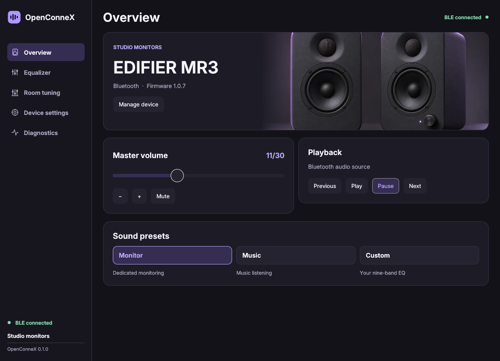

# OpenConneX

A native Windows app for controlling the EDIFIER MR3 over Bluetooth. Adjust the speaker's volume, EQ, and room compensation from your desktop.

[](https://github.com/aesxsc/OpenConneX/releases) [](https://github.com/aesxsc/OpenConneX/actions/workflows/ci.yml) [](LICENSE)

**[Download for Windows x64](https://github.com/aesxsc/OpenConneX/releases)**



## Getting started

1. Download the Windows x64 ZIP from Releases, extract it, and open `OpenConneX.exe`.
2. Turn on the MR3 and switch it to Bluetooth input. OpenConneX scans on startup. If needed, choose **Device settings → Scan nearby**.
3. To play audio from your PC, pair **EDIFIER MR3** in Windows Bluetooth settings and select it as your audio output. Windows streams audio over Classic Bluetooth. OpenConneX uses a separate BLE connection for speaker controls.

## Features and compatibility

- Speaker volume, mute, playback and input controls
- Monitor, Music and Custom presets, a nine-band EQ, and a local preset library
- Low cutoff, acoustic-space compensation, and desktop compensation
- Device discovery, firmware version, and Bluetooth diagnostics

The public beta supports the **EDIFIER MR3 on Windows x64**. Physical testing used MR3 firmware **1.0.7**. Firmware updates use the mobile ConneX app. Other EDIFIER models and Android support are outside this release. See [verification and coverage](docs/verification.md) for the controls exercised on hardware.

## Build from source

Use Rust 1.92 or later with the MSVC toolchain, Visual Studio Build Tools with **Desktop development with C++**, and a Windows SDK.

```powershell
cargo build --release --locked
```

Run `target/release/openconnex.exe`. See [Contributing](CONTRIBUTING.md) for the tests and hardware check.

## Contributing

Start with [GitHub Issues](https://github.com/aesxsc/OpenConneX/issues). Hardware reports, partial protocol findings, experimental device profiles, and improvements to the UI and documentation are welcome. See [CONTRIBUTING.md](CONTRIBUTING.md).

## License

OpenConneX is by [@aesxsc](https://github.com/aesxsc) and licensed under the [WTFPL](LICENSE). Bundled Inter fonts use the [SIL Open Font License](assets/Inter-OFL.txt). Dependency licenses are listed in [Third-party notices](THIRD_PARTY_NOTICES.txt).

OpenConneX is an independent, unofficial project with no affiliation with EDIFIER.
